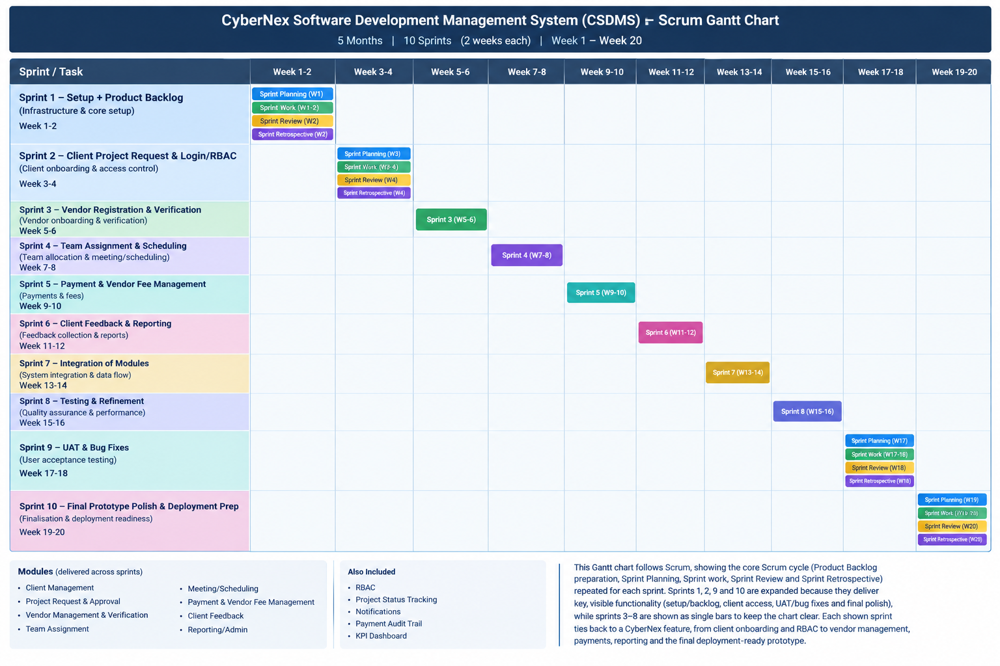
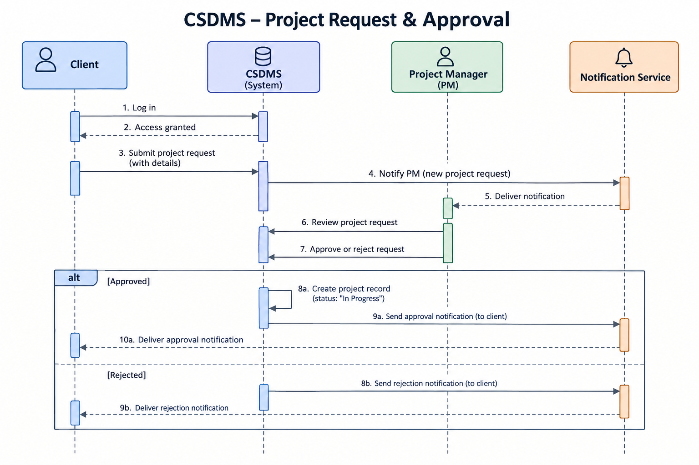

# CyberNex Software Development Management System (CSDMS)

> **Portfolio category:** Systems analysis, SDM planning and UML design  
> **Project context:** University team coursework for a proposed software development management system  
> **Methodology:** Scrum  
> **Planned schedule:** Five months, ten two-week sprints  
> **My documented contributions:** Scrum methodology, two Agile principles, and the Project Request & Approval sequence diagram

## Project overview

CyberNex Solutions is presented in the coursework as a software development company that needs a more organised way to manage client projects and vendor coordination. The proposed CyberNex Software Development Management System (CSDMS) is intended to reduce fragmented, manual processes by bringing key project-management workflows into one system.

The documented functional scope includes:

- Client management and project requests/approval.
- Login, role-based access control (RBAC), and project status tracking.
- Vendor registration, verification, and management.
- Team assignment and meeting/scheduling.
- Payment and vendor-fee management, including payment audit trails.
- Notifications, client feedback, reporting, and an administrative KPI dashboard.

This repository presents the **planning and design work** for the proposed system. It is not a claim that a complete CSDMS application was implemented or deployed.

## Development approach: Scrum

The coursework selects Scrum because the system contains several distinct functional areas that can be planned, reviewed, and refined incrementally. Foundational features such as login and RBAC can be addressed before more involved areas such as vendor workflows, payment management, and reporting.

The documented Scrum roles are:

- **Product Owner:** prioritises the work according to business value.
- **Scrum Master:** helps the team follow the process and removes obstacles.
- **Development Team:** carries out the development work.

The coursework also discusses the Product Backlog, Sprint Backlog, and Increment, and applies sprint planning, execution, review, and retrospective activities to the project.

### Five-month, ten-sprint plan

The Gantt chart organises the proposed work into ten two-week sprints:

| Sprint | Planned focus |
|---|---|
| 1 | Setup and Product Backlog |
| 2 | Client project requests, login, and RBAC |
| 3 | Vendor registration and verification |
| 4 | Team assignment and scheduling |
| 5 | Payment and vendor-fee management |
| 6 | Client feedback and reporting |
| 7 | Integration of modules |
| 8 | Testing and refinement |
| 9 | User acceptance testing (UAT) and bug fixes |
| 10 | Final prototype polish and deployment preparation |

The plan uses stakeholder reviews and retrospectives to identify process or workflow changes during the project rather than leaving all feedback until the end.

## Workflow modelled: Project Request & Approval

The sequence diagram models the interaction between four participants:

1. **Client** — logs in and submits a project request with its details.
2. **CSDMS system** — receives the request and coordinates the workflow.
3. **Project Manager (PM)** — reviews the request and decides whether to approve or reject it.
4. **Notification Service** — delivers the relevant notifications.

The flow is:

1. The client logs in and receives access confirmation.
2. The client submits a project request.
3. CSDMS sends a notification to the Project Manager through the Notification Service.
4. The Project Manager reviews the request and returns an approval or rejection decision.
5. The UML `alt` fragment separates the two outcomes:
   - **Approved:** CSDMS creates a project record with the status **In Progress** and sends an approval notification to the client.
   - **Rejected:** CSDMS sends a rejection notification to the client and does not create a project record.

Modelling both branches makes the order of messages and the responsibilities of each participant explicit before implementation.

## My individual contributions

The submitted assignment identifies the following sections as my individual work:

### 1. Scrum methodology

- Explained Scrum, its roles, and its core artefacts.
- Justified why an iterative approach fits the CSDMS functional scope.
- Applied Scrum activities to the five-month, ten-sprint plan.
- Discussed how frequent reviews can surface workflow gaps and allow reporting requirements to be refined.

### 2. Agile principles

- **Self-organising teams:** explained how developers can select and organise tasks during Sprint Planning based on their strengths, supported by regular team communication.
- **Regular reflection and adjustment (continuous improvement):** explained how sprint retrospectives can identify issues early and guide changes in the next sprint.

### 3. UML sequence diagram

- Modelled the Project Request & Approval workflow.
- Included the Client, CSDMS system, Project Manager, and Notification Service.
- Represented approval and rejection as alternative paths using a UML `alt` fragment.

These are the contributions explicitly identified in the submitted coursework. The overall CSDMS scope and sprint plan are presented as team-project work; they should not be described as an application I independently built.

## Design artefacts

### Scrum Gantt chart

The chart shows the five-month schedule, ten two-week sprints, their planned focus, and how the proposed modules fit across the timeline.

### Project Request & Approval sequence diagram

The diagram shows the messages exchanged by the four participants and the approved/rejected alternatives.

## What this project demonstrates

- Translating a business scenario into a defined system scope and staged development plan.
- Applying Scrum concepts to an incremental project schedule.
- Explaining self-organising teams and continuous improvement in a project context.
- Using a UML sequence diagram to communicate a multi-actor business process.
- Modelling alternative business outcomes and notification behaviour.

## Scope and limitations

The portfolio materials for this entry are the SDM coursework write-up, Scrum Gantt chart, and sequence diagram. They do not provide application source code, automated test results, a deployed URL, or evidence of a running CSDMS system. This entry is therefore accurately described as a **systems-development planning and design case study**, not a completed software product.

The workflow is a design model. Before implementation, details such as input validation, authorisation rules, request-status handling, notification failure handling, and audit requirements would need to be specified and tested.

## CV-ready description

**CyberNex Software Development Management System (CSDMS) — SDM Planning & Design Coursework**

- Contributed Scrum methodology and Agile-principle analysis for a proposed CSDMS, planned as a five-month project across ten two-week sprints.
- Produced a UML sequence diagram for the project-request approval workflow, modelling Client, CSDMS, Project Manager, and Notification Service interactions with approval and rejection paths.

Keep the project labelled as **planning and design coursework** unless you later add verified implementation evidence.

## Interview preparation

Be ready to explain:

1. Why Scrum was selected for this project and how the ten-sprint schedule supports incremental delivery.
2. The difference between the Product Backlog, Sprint Backlog, and Increment.
3. How a Sprint Review differs from a Sprint Retrospective.
4. Why a sequence diagram is useful for the request-and-approval workflow.
5. What the UML `alt` fragment represents and what happens in each branch.
6. Why the rejected path does not create a project record in the documented design.
7. Which deliverables were your individual contributions and which belong to the wider team project.
